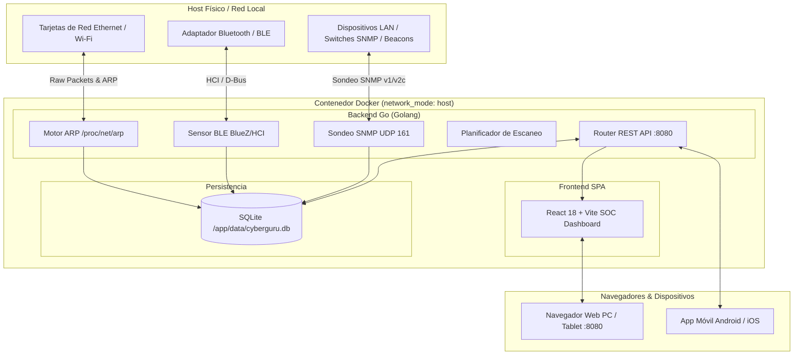

# 🛡️ Cyberguru

Plataforma de ciberseguridad multiplataforma para **PC (Windows/Linux), Android e iOS**, con detección de dispositivos cercanos, escaneo de red, análisis de sensores y dashboard moderno basado en Docker.

---

## 🎯 Descripción

Cyberguru es una suite de ciberseguridad personal y profesional que combina:

- **Escaneo de red local** (ARP, SNMP, detección de dispositivos)
- **Identificación de fabricantes** por MAC (OUI lookup)
- **Consulta de switches** vía SNMP (MAC table + VLANs)
- **Detección de dispositivos BLE/NFC** cercanos
- **Análisis de sensores** (Wi-Fi, Bluetooth, GPS, movimiento)
- **Machine Learning / LLM** para detección de anomalías
- **Dashboard web moderno** accesible desde el navegador

Todo empaquetado en un **contenedor Docker independiente** con backend, base de datos y frontend integrados.

---

## ✨ Características principales

| Módulo | Descripción | Estado |
|---|---|---|
| Escaneo ARP | Detección de dispositivos en LAN | ✅ |
| OUI Lookup | Identificación de vendor por MAC | ✅ |
| SNMP Switch Query | Extracción de MAC table y VLANs | ✅ |
| BLE Scanner | Detección de dispositivos Bluetooth cercanos | ✅ |
| NFC Reader | Lectura de tags NFC (Android) | 🚧 |
| Dashboard Web | Visualización en tiempo real | ✅ |
| Alertas | Detección de anomalías (ARP spoofing, nuevos dispositivos) | 🚧 |
| ML/LLM | Análisis inteligente de eventos | 🔜 |

---

## 🏗️ Arquitectura

La arquitectura de Cyberguru está diseñada para ser completamente modular y de bajo impacto en recursos del sistema, integrando captura de bajo nivel con una interfaz web moderna servida desde un único contenedor:



### Componentes de la Arquitectura

1. **Capa de Red del Host (`network_mode: host`):**
   - El contenedor comparte la pila de red física del equipo anfitrión sin puente virtual intermediario.
   - Habilita el envío de broadcast ARP, la captura de respuestas de la subred local `/24` y la comunicación directa por sockets crudos (`NET_RAW`).

2. **Capa de Backend (Go / Golang):**
   - **Binario Estático Ultraligero:** Compilado sin CGO (`CGO_ENABLED=0`), ocupando ~15 MB y consumiendo <25 MB de memoria RAM.
   - **Concurrencia Nativa:** Goroutines de alta velocidad para sondeo de rangos completos de red en milisegundos.
   - **Servidor HTTP Unificado:** Despacha la API REST (`/api/*`) y distribuye los archivos de la SPA en el puerto `8080`.

3. **Capa de Persistencia (SQLite):**
   - Motor integrado puro en Go sin dependencias de librerías externas del sistema.
   - Mapeado en el volumen persistente Docker `cyberguru_data` para salvaguardar el inventario y las alertas ante recreaciones del contenedor.

4. **Capa de Visualización (React + Vite):**
   - Interfaz con diseño de centro de operaciones de seguridad (SOC).
   - Métricas en vivo, consola de alertas interactiva y filtrado rápido por tecnología (Ethernet, WiFi, SNMP, BLE).

---

## 📁 Estructura del Proyecto

```
Cyberguru/
├── Dockerfile                  # Construcción multi-etapa (Node -> Go -> Alpine)
├── docker-compose.yml          # Definición de servicio con network_mode: host
├── .dockerignore               # Optimización del contexto de Docker
├── README.md                   # Documentación principal
├── backend/
│   ├── go.mod                  # Módulo y dependencias Go
│   ├── main.go                 # Entrada principal, ciclo de vida y servidor HTTP
│   ├── config/config.go        # Configuración por variables de entorno
│   ├── models/models.go        # Estructuras de datos (Device, Alert, Stats)
│   ├── db/database.go          # Migraciones y operaciones SQLite
│   ├── scanner/
│   │   ├── scanner.go          # Coordinador del motor de escaneo
│   │   ├── arp.go              # Barrido ARP y tabla OUI de fabricantes
│   │   ├── snmp.go             # Sondeo SNMP v1/v2c (UDP 161)
│   │   └── ble.go              # Escáner BLE y telemetría de proximidad
│   └── api/router.go           # Endpoints REST y servidor de archivos estáticos
└── frontend/
    ├── package.json            # Dependencias de React y Vite
    ├── vite.config.js          # Configuración de compilación y proxy
    ├── index.html              # HTML de entrada
    └── src/
        ├── main.jsx            # Entrada de React
        ├── App.jsx             # Vista principal del dashboard SOC
        ├── index.css           # Sistema de diseño oscuro y estilos neón
        └── components/
            ├── Icons.jsx       # Iconos vectoriales integrados
            ├── Header.jsx      # Barra de estado y hora en tiempo real
            ├── MetricCard.jsx  # Tarjetas estadísticas glassmorphism
            ├── ScannerPanel.jsx# Controles para disparar escaneos
            ├── DeviceTable.jsx # Inventario de dispositivos con filtros
            └── AlertFeed.jsx   # Consola de alertas de seguridad
```

---

## 🚀 Despliegue con Docker Compose

### Requisitos Previos
- Docker Engine / Docker Desktop en ejecución.
- En Linux: Permisos para sockets y administración de red (`sudo` o grupo `docker`).

### Construcción y Ejecución

Para construir y levantar el contenedor en segundo plano:

```bash
docker-compose up --build -d
```

Una vez levantado el servicio, accede desde cualquier navegador en la red:
👉 **[http://localhost:8080](http://localhost:8080)**

### Comandos de Utilidad

```bash
# Ver los registros del escáner en tiempo real
docker-compose logs -f cyberguru

# Comprobar el estado del contenedor
docker-compose ps

# Detener el contenedor
docker-compose down
```

---

## 📱 App Móvil Android (APK)

Cyberguru cuenta con soporte nativo para **Android** empaquetado con Capacitor y Gradle, permitiendo ejecutar el escáner y el dashboard SOC directamente en tu smartphone o tablet Android:

### Compilar la APK

- **En Windows (PowerShell):**
  ```powershell
  .\build-apk.ps1
  ```
- **En Linux / macOS (Bash):**
  ```bash
  chmod +x build-apk.sh
  ./build-apk.sh
  ```

### Instalación en el Dispositivo

El binario compilado se genera en la raíz del proyecto como `Cyberguru.apk` (~4.1 MB). Para instalarlo mediante ADB por USB o Wi-Fi:

```bash
adb install -r Cyberguru.apk
```

O transfiere directamente `Cyberguru.apk` a tu dispositivo móvil e instálalo seleccionando *"Instalar desde fuentes desconocidas"*.

### Capacidades en Android
- **Modo Móvil Autónomo:** Escaneo local de dispositivos Wi-Fi en la red del teléfono, detección de balizas BLE de proximidad y almacenamiento persistente en el dispositivo.
- **Conexión a Servidor Central:** Posibilidad de vincular la app a un servidor Cyberguru Docker remoto en la red (ej. `http://192.168.1.100:8080`) para sincronizar alertas y telemetría de toda la infraestructura.

```bash
# Ver los registros del escáner en tiempo real
docker-compose logs -f cyberguru

# Comprobar el estado del contenedor
docker-compose ps

# Detener el contenedor
docker-compose down
```

---

## 📡 API REST

| Método | Endpoint | Descripción | Parámetros / Carga |
|---|---|---|---|
| `GET` | `/api/health` | Estado del agente, escáner y tiempo de actividad | Ninguno |
| `GET` | `/api/stats` | Resumen de métricas para el dashboard | Ninguno |
| `GET` | `/api/devices` | Lista de dispositivos detectados | `?type=BLE&status=online` |
| `GET` | `/api/alerts` | Lista de alertas de seguridad | `?pending=true` |
| `POST` | `/api/alerts/{id}/ack` | Marcar alerta como atendida/resuelta | ID de alerta en ruta |
| `POST` | `/api/scan` | Disparar escaneo manual bajo demanda | `{"scan_type": "all\|arp\|snmp\|ble"}` |
| `GET` | `/*` | Distribución de la SPA de React | Servidor estático |

---

## ⚙️ Variables de Entorno

| Variable | Valor por Defecto | Descripción |
|---|---|---|
| `PORT` | `8080` | Puerto en el que escucha la interfaz web y la API |
| `DB_PATH` | `/app/data/cyberguru.db` | Ruta del archivo de base de datos SQLite |
| `FRONTEND_DIR` | `/app/frontend/dist` | Directorio con los activos compilados de la SPA |
| `SCAN_INTERFACE` | *(Auto-detección)* | Interfaz de red física preferida (ej. `eth0`, `wlan0`) |
| `SCAN_INTERVAL_MIN` | `5` | Minutos entre escaneos automáticos periódicos |
| `SIMULATE_BLE_IF_ABSENT` | `true` | Provee telemetría BLE demostrativa si el host carece de hardware Bluetooth |

---

## 🗺️ Hoja de Ruta (Roadmap)

- [x] Contenedor Docker autónomo multi-etapa (<50 MB).
- [x] Soporte nativo para `network_mode: host` con capacidades `NET_ADMIN` y `NET_RAW`.
- [x] Escaneo ARP con resolución de OUI y detección de nuevas MACs.
- [x] Consultas SNMP v1/v2c para detección de switches y sistemas abiertos.
- [x] Detección de balizas y etiquetas de rastreo BLE.
- [x] Dashboard interactivo React con tema SOC oscuro y actualización en tiempo real.
- [ ] Detección avanzada de ataques ARP Spoofing / Poisoning mediante correlación temporal.
- [ ] Módulo NFC Reader para dispositivos móviles Android.
- [ ] Integración con LLM local / Gemini API para triaje automático de anomalías y sugerencias de remediación.
- [ ] Exportación de reportes de auditoría en formato PDF y JSON.

---

## 📄 Licencia

Este proyecto se distribuye bajo los términos y condiciones de la licencia MIT. Diseñado para auditorías de seguridad defensivas y administración de infraestructuras de red autorizadas.
