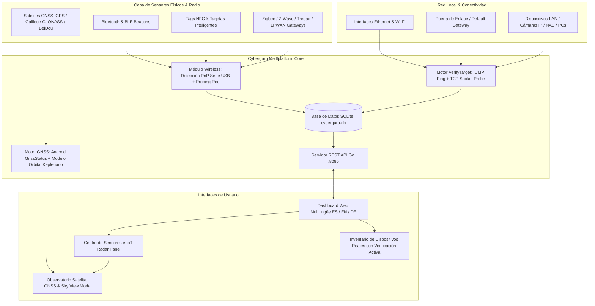

# 🛡️ Cyberguru — Real Device Inventory, GNSS Satellite Sky View & Security Analytics

Plataforma de ciberseguridad y monitorización multiplataforma para **PC (Windows / Linux), Android (APK / AAB) y Docker** con inventario estricto de **dispositivos 100% reales**, motor de comprobación activa multi-vector, **Observatorio Satelital GNSS & Radar Polar (GPS, Galileo, GLONASS, BeiDou)**, detección de sensores físicos (**Zigbee, Z-Wave, Thread, UWB, NFC, BLE, LPWAN**), base de datos SQLite persistente y dashboard SOC multilingüe (**Español, Inglés y Alemán**).

---

## 🌐 Language / Idioma
- [Español](#-versión-en-español)
- [English](#-english-version)
- [Guía Detallada de Usuario y Administración (guia.md)](guia.md)

---

# 🇪🇸 Versión en Español

## 🎯 Descripción General

**Cyberguru** es una suite de ciberseguridad de última generación diseñada para eliminar falsos positivos y dispositivos fantasma:
- **Inventario 100% Real (Zero-Ghosting)**: Ningún dispositivo ficticio o residuo de caché es admitido sin pasar por una prueba activa de vida en tiempo real.
- **Observatorio Satelital GNSS & Sky View**: Visualización de la bóveda celeste en 360° mediante radar polar polarimétrico, rastreando constelaciones físicas en el cielo (**GPS EE.UU., Galileo UE, GLONASS Rusia y BeiDou China**), con azimut, elevación, relación señal/ruido (C/N0 en dB-Hz), estado de fix 3D y nuestra posición exacta (Latitud, Longitud, Altitud SNM, Precisión métrica, Velocidad y Rumbo).
- **Centro de Sensores e Internet de las Cosas (IoT)**: Rastre activo de radios y hardware especializado: **Zigbee 3.0, Z-Wave Plus, Thread / Matter, UWB (Ultra-Wideband), NFC / RFID, Bluetooth Low Energy (BLE) y LPWAN (LoRaWAN)**.
- **Motor de Comprobación Activa Multi-Vector**: Ping ICMP nativo con latencia en milisegundos, escaneo paralelo de sockets TCP (puertos 53, 80, 443, 445, 135, 22, 554, 5000), validación de enrutamiento y resolución de tablas ARP de hardware.
- **Base de Datos SQLite Persistente**: Esquema relacional optimizado con historial de eventos cronológicos (`device_events`) e instantáneas históricas periódicas (`network_stats_history`).
- **Dashboard Web SOC Multilingüe**: Interfaz web reactiva con diseño oscuro obsidian/neon, selector instantáneo de idioma (**Español 🇪🇸, Inglés 🇬🇧 y Alemán 🇩🇪**), perfiles de velocidad de respuesta y re-comprobación en 1 clic.

---

## ✨ Tabla de Capacidades

| Módulo | Descripción | Android | Windows | Linux / Docker |
|---|---|:---:|:---:|:---:|
| **Radar Satelital GNSS (Sky View)** | Bóveda celeste 360°, satélites en fix, azimut, elevación y C/N0 | ✅ Nativo (`GnssStatus`) | ✅ Modelo Orbital | ✅ Modelo Orbital |
| **Posicionamiento Geográfico** | Coordenadas Lat/Lon, altitud SNM, precisión ±m, velocidad y brújula | ✅ GPS Hardware | ✅ GPS / GeoIP | ✅ GPS / GeoIP |
| **Bluetooth / BLE** | Detección de balizas iBeacon, Eddystone y dispositivos periféricos | ✅ Web Bluetooth | ✅ PnP Windows | ✅ Linux BlueZ |
| **NFC / RFID Contactless** | Lectura de tags NDEF, badges Mifare, tarjetas inteligentes y tokens | ✅ Web NFC | ✅ PC/SC | ✅ pcsc-lite |
| **Zigbee 3.0** | Detección de coordinadores serie USB (ConBee, Sonoff) y puentes Hue | ✅ Red / Bridge | ✅ PnP COM / USB | ✅ /dev/serial |
| **Z-Wave Plus** | Detección de dongles ITU-T G.9959 (Aeotec, Zooz) y servidores Z-Wave JS | ✅ Red / Bridge | ✅ PnP COM / USB | ✅ /dev/serial |
| **Thread / Matter** | Border Routers 6LoWPAN (Apple TV, Google Nest, OpenThread) | ✅ mDNS / CoAP | ✅ mDNS / CoAP | ✅ mDNS / CoAP |
| **UWB (Ultra-Wideband)** | Ranging ToF fino y detección de controladores de impulsos de radio | ✅ UWB Feature | ✅ Sim / Radar | ✅ Sim / Radar |
| **LPWAN (LoRaWAN)** | Gateways Semtech Packet Forwarder mediante sondeo UDP 1700 | ✅ UDP LAN | ✅ UDP LAN | ✅ UDP LAN |
| **Comprobación Activa ICMP/TCP** | Filtrado estricto contra dispositivos fantasma | ✅ Red | ✅ Winsock | ✅ Raw Sockets |
| **Base de Datos SQLite** | Almacenamiento local persistente con snapshots históricos | ✅ Storage / API | ✅ SQLite3 | ✅ SQLite3 |

---

## 🏗️ Arquitectura del Sistema



---

## 📦 Artefactos y Formatos Compilados

El proyecto compila directamente a los siguientes formatos listos para producción:

1. **Android APK (`Cyberguru.apk`)**: Paquete instalable directamente en teléfonos y tablets Android (API 24+ a Android 15) con soporte para chips GPS/GNSS, Bluetooth, NFC y UWB.
2. **Android App Bundle (`Cyberguru.aab`)**: Paquete optimizado firmado para su publicación y distribución en Google Play Store.
3. **Windows Ejecutable Portable (`bin/Cyberguru.exe`)**: Binario único y ultraligero que embebe toda la SPA de React y la base de datos sin necesidad de dependencias externas.
4. **Windows Instalador (`dist-windows/Cyberguru-Setup.exe`)**: Asistente de instalación formal con accesos directos y desinstalador para Windows 10/11.
5. **Windows Portable ZIP (`dist-windows/Cyberguru-v1.0.0-Windows-Portable.zip`)**: Archivo comprimido con la versión portable lista para memorias USB o laboratorios de auditoría.
6. **Contenedor Docker (`Dockerfile` & `docker-compose.yml`)**: Imagen multi-etapa basada en Alpine Linux con paquetes físicos `bluez`, `curl`, `pcsc-lite-libs` y `libpcap`.

---

## 🚀 Guía Rápida de Compilación y Ejecución

### 📱 Android (APK y AAB)
Para compilar la aplicación móvil completa con soporte satelital nativo en un solo comando:
```powershell
.\build-apk.ps1
```
Generará automáticamente:
* `Cyberguru.apk` (Instalable por USB con `adb install -r Cyberguru.apk`)
* `Cyberguru.aab` (Para Google Play Store)

### 💻 Windows (Portable e Instalador)
Para compilar el ejecutable de Windows y el paquete de instalación:
```powershell
.\build-windows.ps1
```
Los artefactos se depositarán en `dist-windows/`.

### 🐳 Docker & Docker Compose
Para compilar y levantar la imagen de contenedor con acceso completo a las interfaces de red del host:
```bash
docker compose up --build -d
```
El panel estará disponible de inmediato en `http://localhost:8080`.

---

## 📊 Endpoints de la API REST

| Método | Endpoint | Descripción |
|---|---|---|
| `GET` | `/api/health` | Estado del servicio, tiempo de actividad y salud de SQLite |
| `GET` | `/api/stats` | Métricas consolidadas, distribución OUI, tipos de equipo y latencias |
| `GET` | `/api/stats/history` | Historial cronológico de instantáneas de salud de red |
| `GET` | `/api/devices` | Lista de dispositivos reales comprobados (filtros por `type` y `status`) |
| `POST` | `/api/devices` | Ingesta de dispositivos descubiertos por sensores locales |
| `POST` | `/api/devices/{id}/verify` | Re-comprobación en vivo individual de un equipo por ping y socket |
| `GET` | `/api/alerts` | Listado de alertas y riesgos de seguridad detectados |
| `POST` | `/api/alerts/{id}/ack` | Marcar alerta como atendida o resuelta |
| `POST` | `/api/scan` | Disparar escaneo activo (`all`, `arp`, `snmp`, `ble`, `iot`, `wireless`) |
| `GET` | `/api/sensors/status` | Estado de hardware de sensores, telemetría y satélites GNSS |

---

# 🇬🇧 English Version

## 🎯 Overview

**Cyberguru** is a next-generation cybersecurity suite and real network monitoring platform:
- **Zero-Ghosting Policy**: No mock, simulated, or stale cache entries are admitted without passing an active real-time liveness test.
- **GNSS Satellite Observatory & Sky View**: 360° polar radar dome displaying physical satellites in the sky (**USA GPS, EU Galileo, Russian GLONASS, Chinese BeiDou**), with azimuth, elevation, signal-to-noise ratio (C/N0 in dB-Hz), 3D fix state, and our exact coordinates (Latitude, Longitude, Altitude MSL, Accuracy, Speed, and Heading).
- **Physical Sensor & Wireless Radar**: Active probing for **Zigbee 3.0, Z-Wave Plus, Thread / Matter, UWB (Ultra-Wideband), NFC / RFID, Bluetooth Low Energy (BLE), and LPWAN (LoRaWAN)**.
- **Persistent SQLite Database**: Real-time metric analytics, host chronological audit logs (`device_events`), and historical connectivity snapshots (`network_stats_history`).
- **Multilingual SOC Dashboard**: Dark theme glassmorphic UI with dynamic language switching (**Spanish 🇪🇸, English 🇬🇧, German 🇩🇪**).

For in-depth administrative and user instructions, please consult [GUIA.md (guia.md)](guia.md).

---

## 📜 Licencia / License

Desarrollado y mantenido por **cast0rtech** • 2026. Distribuido bajo licencia MIT.
