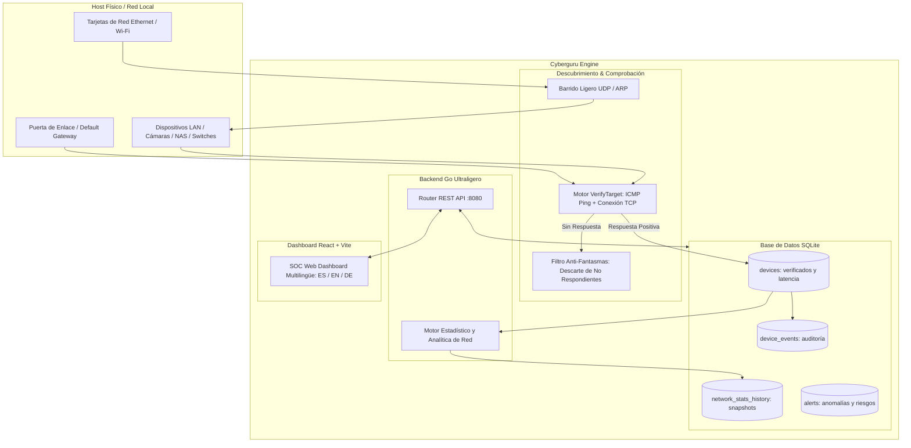

# 🛡️ Cyberguru — Real Device Inventory & Security Analytics

Plataforma de ciberseguridad multiplataforma para **PC (Windows/Linux), Android e iOS** con inventario estricto de **dispositivos 100% reales**, motor de comprobación activa multi-vector, base de datos SQLite para estadísticas de red y dashboard SOC multilingüe (**Español, Inglés y Alemán**).

---

## 🌐 Language / Idioma
- [Español](#-versión-en-español)
- [English](#-english-version)

---

# 🇪🇸 Versión en Español

## 🎯 Descripción General

**Cyberguru** es una suite de ciberseguridad y monitorización de red diseñada para eliminar falsos positivos y dispositivos fantasma:
- **Inventario de Dispositivos 100% Reales**: Ningún dispositivo ficticio, simulado o residuo de caché es admitido sin pasar primero por una prueba activa de vida.
- **Motor de Comprobación Activa Multi-Vector**: Cada candidato descubierto es probado en tiempo real mediante **Ping ICMP nativo** (con medición de latencia en milisegundos), **escaneo paralelo de sockets TCP** (puertos DNS 53, HTTP 80, HTTPS 443, SMB 445, RPC 135, SSH 22, RTSP 554, DSM 5000), validación de enrutamiento del sistema operativo y resolución de tablas de vecinos ARP.
- **Base de Datos SQLite para Estadísticas y Auditoría**: Esquema relacional con tablas de dispositivos comprobados, auditoría cronológica de eventos (`device_events`) e instantáneas históricas periódicas (`network_stats_history`) para análisis de tendencias de conectividad.
- **Dashboard Web SOC Multilingüe**: Interfaz web moderna con selector instantáneo de idioma (**Español 🇪🇸, Inglés 🇬🇧 y Alemán 🇩🇪**), perfiles de latencia, clasificación de hardware por OUI y re-comprobación individual en 1 clic.

---

## ✨ Características Principales

| Módulo | Descripción | Estado |
|---|---|---|
| **Comprobación Activa Previa** | Validación estricta por ICMP y TCP antes de enrolar en inventario | ✅ Activo |
| **Purga de Mocks y Datos Residuales** | Eliminación automática de datos simulados y candidatos sin respuesta | ✅ Activo |
| **Base de Datos & Estadísticas** | Métricas en tiempo real, latencias, distribución OUI y snapshots en SQLite | ✅ Activo |
| **Auditoría de Eventos** | Registro histórico cronológico de cambios de estado y latencia por host | ✅ Activo |
| **Detección de Gateway & Host** | Identificación precisa del router principal y de la propia máquina anfitriona | ✅ Activo |
| **Rastreo de Cámaras & NAS** | Inspección de flujos RTSP/ONVIF y servidores de almacenamiento SMB/DSM | ✅ Activo |
| **Sondeo SNMP v1/v2c** | Consulta UDP en puerto 161 a switches y routers gestionados | ✅ Activo |
| **Detección BLE Física** | Sensores Bluetooth Low Energy nativos (sin simulación artificial) | ✅ Activo |
| **Dashboard Multilingüe** | Selector dinámico de idioma (Español, Inglés y Alemán) | ✅ Activo |

---

## 🏗️ Arquitectura del Sistema



---

## 📊 Endpoints de la API REST

| Método | Endpoint | Descripción |
|---|---|---|
| `GET` | `/api/health` | Estado del servicio, tiempo de actividad y base de datos |
| `GET` | `/api/devices` | Lista de dispositivos comprobados (filtrable por `type` y `status`) |
| `POST` | `/api/devices/{id}/verify` | **Re-comprobación en vivo** individual de un dispositivo por ping/socket |
| `GET` | `/api/devices/{id}/events` | Historial cronológico de eventos de un dispositivo específico |
| `GET` | `/api/stats` | Métricas consolidadas, distribución OUI, tipos de equipo y latencias |
| `GET` | `/api/stats/history` | Instantáneas históricas de red registradas en SQLite |
| `POST` | `/api/scan` | Dispara ciclo de escaneo (`arp`, `snmp`, `iot`, `ble`, `all`) |
| `POST` | `/api/cleanup-fake` | Purgar datos ficticios heredados y dejar solo equipos reales |
| `GET` | `/api/alerts` | Registro de alertas de ciberseguridad |
| `POST` | `/api/alerts/{id}/ack` | Marcar alerta de seguridad como resuelta |

---

## 🚀 Puesta en Marcha Rápida

### Opción 1: Windows Portable (Sin dependencias externas)
1. Descarga el paquete `Cyberguru-v1.0.0-Windows-Portable.zip` desde `dist-windows/`.
2. Descomprime en cualquier carpeta o memoria USB.
3. Ejecuta `Cyberguru.exe` o `Lanzar-Cyberguru.bat`.
4. El dashboard se abrirá automáticamente en `http://localhost:8080`.

### Opción 2: Compilación con PowerShell
```powershell
.\build-windows.ps1
```

### Opción 3: Docker (Linux / Windows WSL2)
```bash
docker compose up -d --build
```

---
---

# 🇬🇧 English Version

## 🎯 Overview

**Cyberguru** is a cross-platform cybersecurity and network inventory platform engineered to eliminate ghost devices and false positives:
- **100% Real Device Inventory**: No mock, simulated, or stale ARP entries are enrolled without passing strict active liveness verification.
- **Multi-Vector Active Verification Engine**: Every discovered network candidate is tested in real-time using **native ICMP Ping** (measuring round-trip latency in milliseconds), **concurrent TCP socket probing** (DNS port 53, HTTP 80, HTTPS 443, SMB 445, RPC 135, SSH 22, RTSP 554, DSM 5000), OS routing table resolution, and ARP neighbor state validation.
- **SQLite Database for Statistics & Audit History**: Relational persistence featuring verified devices, chronological event tracking (`device_events`), and periodic historical snapshots (`network_stats_history`) for network trend analysis.
- **Multilingual SOC Dashboard**: High-performance cyber dashboard with instantaneous language switching (**English 🇬🇧, Spanish 🇪🇸, and German 🇩🇪**), latency distribution profiles, OUI hardware identification, and 1-click on-demand verification.

---

## ✨ Key Capabilities

| Feature | Description | Status |
|---|---|---|
| **Pre-Enrollment Verification** | Strict ICMP and TCP checks before device registration | ✅ Active |
| **Mock & Ghost Purge** | Automatic cleanup of simulated data and unresponsive hosts | ✅ Active |
| **Database & Statistics** | Real-time KPIs, latency tracking, OUI vendor distribution, snapshots | ✅ Active |
| **Device Event Auditing** | Chronological audit trail of host status changes and latency updates | ✅ Active |
| **Gateway & Host Resolution** | Automatic recognition of default router and local workstation | ✅ Active |
| **IP Cameras & NAS Tracking** | RTSP/ONVIF surveillance streams and SMB/DSM storage detection | ✅ Active |
| **SNMP v1/v2c Querying** | UDP 161 polling for managed routers, switches, and industrial nodes | ✅ Active |
| **Physical BLE Discovery** | Native Bluetooth Low Energy scanning (pure hardware, no simulation) | ✅ Active |
| **Multilingual Dashboard** | Dynamic UI language switcher (English, Spanish, German) | ✅ Active |

---

## 🏗️ Architecture Overview

1. **Host Network Layer (`network_mode: host`):**
   Direct interaction with physical network interfaces for ARP discovery, raw socket communication, and accurate neighbor table inspection.
2. **Go Backend Core:**
   Lightweight, static Go binary running concurrent verification routines and unified HTTP serving for both REST endpoints and frontend SPA.
3. **Persistent SQLite Database:**
   Relational storage preserving real device records, device audit logs, time-series network snapshots, and security alerts.
4. **React SOC Frontend:**
   Glassmorphic dark cyber interface with live polling, device status badges, responsive charts, and full i18n support.

---

## 📊 REST API Reference

| Method | Endpoint | Description |
|---|---|---|
| `GET` | `/api/health` | Agent operational status, uptime, and database integrity |
| `GET` | `/api/devices` | Retrieve verified devices (filter by `type` and `status`) |
| `POST` | `/api/devices/{id}/verify` | **Live on-demand re-verification** of an individual host |
| `GET` | `/api/devices/{id}/events` | Chronological event history for a specific device |
| `GET` | `/api/stats` | Aggregated network statistics, OUI breakdown, latency distribution |
| `GET` | `/api/stats/history` | Historical time-series network snapshots from SQLite |
| `POST` | `/api/scan` | Trigger active scan cycle (`arp`, `snmp`, `iot`, `ble`, `all`) |
| `POST` | `/api/cleanup-fake` | Purge legacy mock devices and retain only verified hardware |
| `GET` | `/api/alerts` | List detected cybersecurity risk alerts |
| `POST` | `/api/alerts/{id}/ack` | Acknowledge security finding |

---

## 🚀 Quick Start Guide

### Option 1: Windows Portable (Zero Dependencies)
1. Extract `Cyberguru-v1.0.0-Windows-Portable.zip` from `dist-windows/`.
2. Run `Cyberguru.exe` or `Lanzar-Cyberguru.bat`.
3. Open your browser at `http://localhost:8080`.

### Option 2: Automated Windows Build
```powershell
.\build-windows.ps1
```

### Option 3: Docker Deployment
```bash
docker compose up -d --build
```

---

## 📜 License & Author
- **Author:** `cast0rtech`
- **License:** MIT License © 2026 Cyberguru Security Suite
